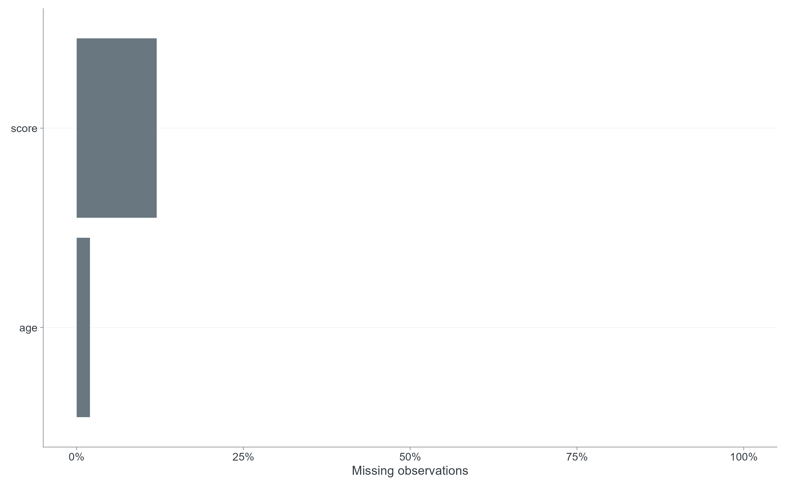
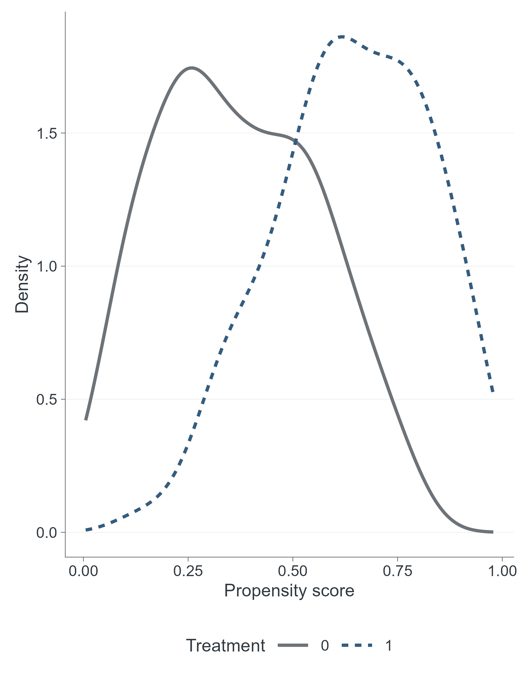
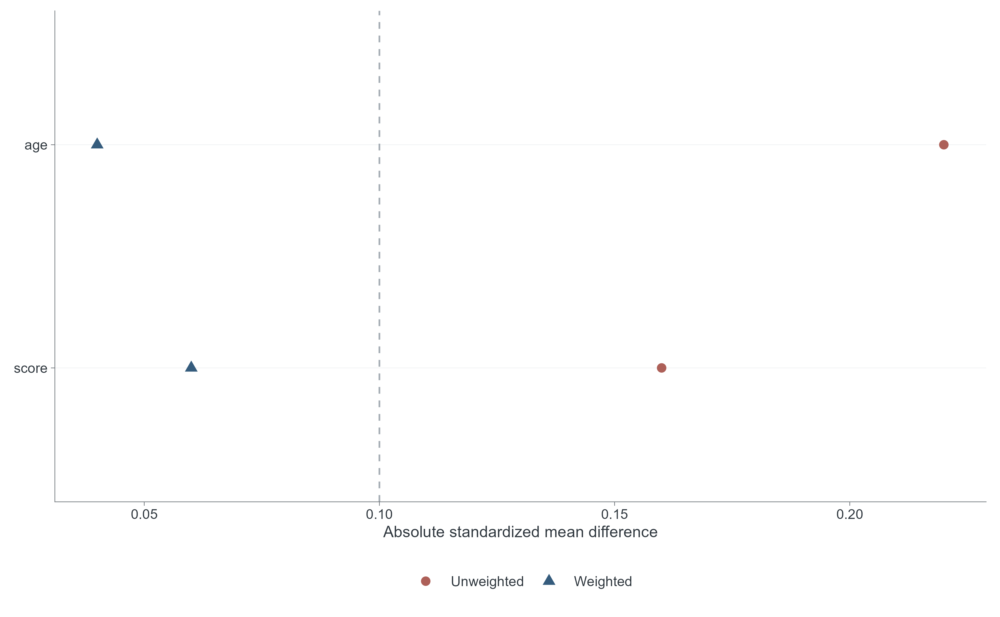
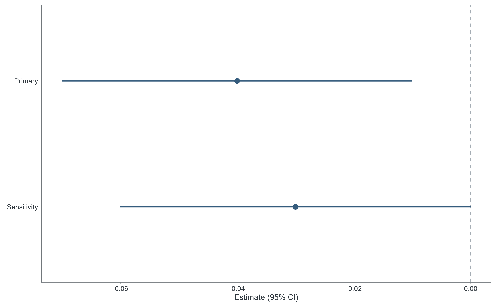
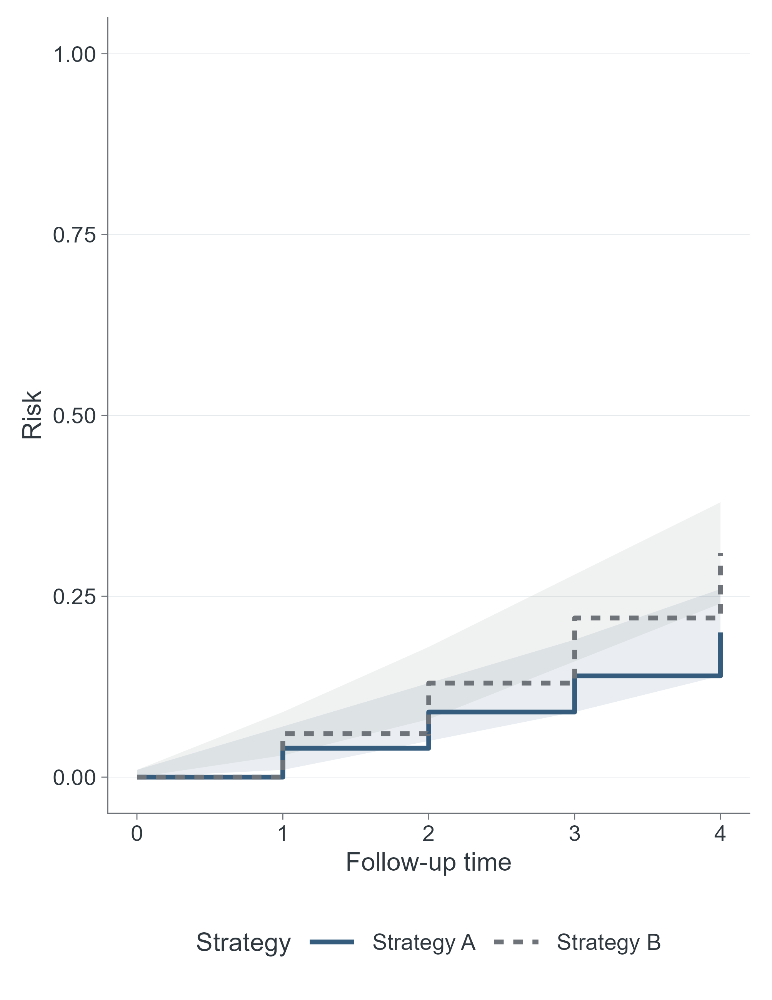
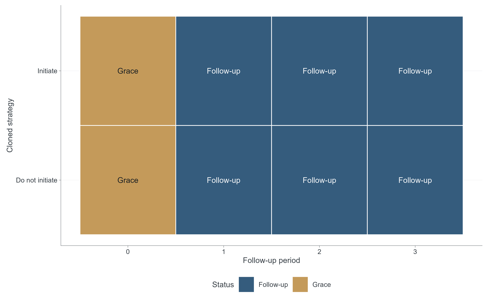
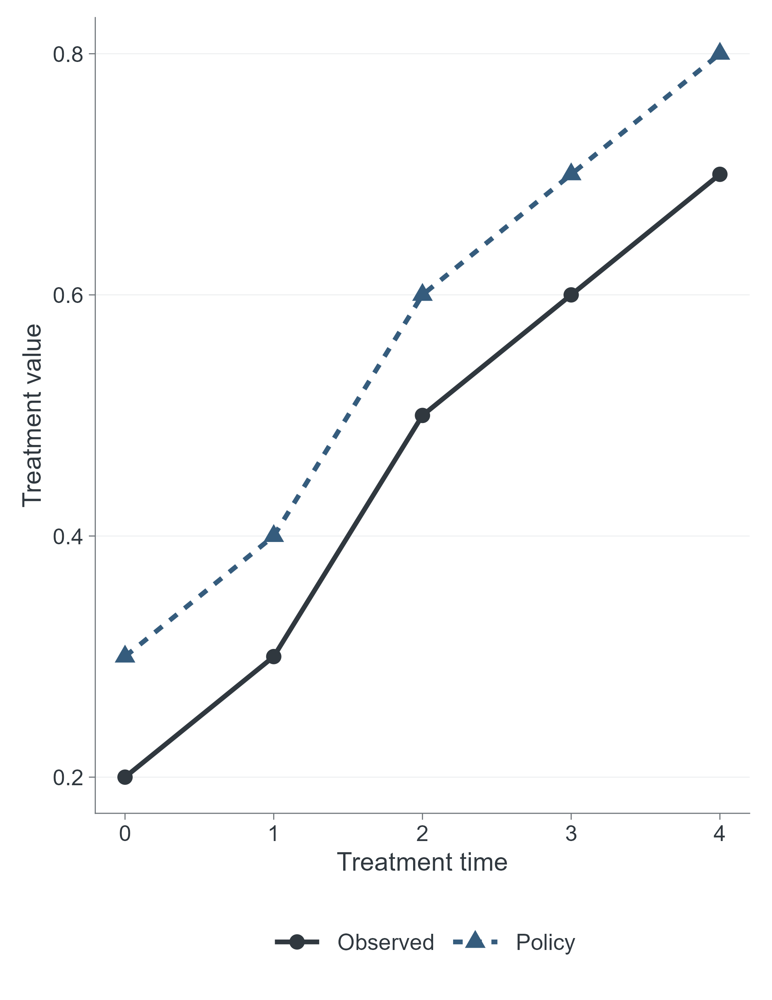

# SCI Figure Style v1.1 Candidate

14 native figure variants using unchanged v1.0.0 synthetic fixtures (seed 20260809).

All candidates retain publication_ready=FALSE and manual_review=PENDING. This gallery is a visual review aid; it grants no scientific or publication approval.

See [before/after comparison](../figure_style_comparison/README.md), [accessibility validation](../reports/sci_palette_accessibility_validation.md) and [candidate report](../reports/sci_figure_style_v1_1_candidate.md).

Both requested widths (85 and 178 mm) are exported in PDF, SVG, TIFF and PNG. Raster files use 600 DPI. Native R vector canvases are quantized to whole points; actual dimensions are recorded in [export validation](export_validation.csv).

## 01 cohort flow

85 mm: [PDF](single/figure_01_cohort_flow.pdf) · [SVG](single/figure_01_cohort_flow.svg) · [TIFF](single/figure_01_cohort_flow.tiff) · [PNG](single/figure_01_cohort_flow.png)

178 mm: [PDF](double/figure_01_cohort_flow.pdf) · [SVG](double/figure_01_cohort_flow.svg) · [TIFF](double/figure_01_cohort_flow.tiff) · [PNG](double/figure_01_cohort_flow.png)

Review: [Grayscale](accessibility/figure_01_cohort_flow_grayscale.png) · [Deutan](accessibility/figure_01_cohort_flow_deutan.png) · [Protan](accessibility/figure_01_cohort_flow_protan.png) · [Tritan](accessibility/figure_01_cohort_flow_tritan.png)

## 02 missingness

85 mm: [PDF](single/figure_02_missingness.pdf) · [SVG](single/figure_02_missingness.svg) · [TIFF](single/figure_02_missingness.tiff) · [PNG](single/figure_02_missingness.png)

178 mm: [PDF](double/figure_02_missingness.pdf) · [SVG](double/figure_02_missingness.svg) · [TIFF](double/figure_02_missingness.tiff) · [PNG](double/figure_02_missingness.png)

Review: [Grayscale](accessibility/figure_02_missingness_grayscale.png) · [Deutan](accessibility/figure_02_missingness_deutan.png) · [Protan](accessibility/figure_02_missingness_protan.png) · [Tritan](accessibility/figure_02_missingness_tritan.png)

## 03 propensity score distribution

85 mm: [PDF](single/figure_03_propensity_score_distribution.pdf) · [SVG](single/figure_03_propensity_score_distribution.svg) · [TIFF](single/figure_03_propensity_score_distribution.tiff) · [PNG](single/figure_03_propensity_score_distribution.png)

178 mm: [PDF](double/figure_03_propensity_score_distribution.pdf) · [SVG](double/figure_03_propensity_score_distribution.svg) · [TIFF](double/figure_03_propensity_score_distribution.tiff) · [PNG](double/figure_03_propensity_score_distribution.png)

Review: [Grayscale](accessibility/figure_03_propensity_score_distribution_grayscale.png) · [Deutan](accessibility/figure_03_propensity_score_distribution_deutan.png) · [Protan](accessibility/figure_03_propensity_score_distribution_protan.png) · [Tritan](accessibility/figure_03_propensity_score_distribution_tritan.png)

## 04 weight distribution

85 mm: [PDF](single/figure_04_weight_distribution.pdf) · [SVG](single/figure_04_weight_distribution.svg) · [TIFF](single/figure_04_weight_distribution.tiff) · [PNG](single/figure_04_weight_distribution.png)

178 mm: [PDF](double/figure_04_weight_distribution.pdf) · [SVG](double/figure_04_weight_distribution.svg) · [TIFF](double/figure_04_weight_distribution.tiff) · [PNG](double/figure_04_weight_distribution.png)

Review: [Grayscale](accessibility/figure_04_weight_distribution_grayscale.png) · [Deutan](accessibility/figure_04_weight_distribution_deutan.png) · [Protan](accessibility/figure_04_weight_distribution_protan.png) · [Tritan](accessibility/figure_04_weight_distribution_tritan.png)

## 05 love plot

85 mm: [PDF](single/figure_05_love_plot.pdf) · [SVG](single/figure_05_love_plot.svg) · [TIFF](single/figure_05_love_plot.tiff) · [PNG](single/figure_05_love_plot.png)

178 mm: [PDF](double/figure_05_love_plot.pdf) · [SVG](double/figure_05_love_plot.svg) · [TIFF](double/figure_05_love_plot.tiff) · [PNG](double/figure_05_love_plot.png)

Review: [Grayscale](accessibility/figure_05_love_plot_grayscale.png) · [Deutan](accessibility/figure_05_love_plot_deutan.png) · [Protan](accessibility/figure_05_love_plot_protan.png) · [Tritan](accessibility/figure_05_love_plot_tritan.png)

## 06 standardized balance

85 mm: [PDF](single/figure_06_standardized_balance.pdf) · [SVG](single/figure_06_standardized_balance.svg) · [TIFF](single/figure_06_standardized_balance.tiff) · [PNG](single/figure_06_standardized_balance.png)

178 mm: [PDF](double/figure_06_standardized_balance.pdf) · [SVG](double/figure_06_standardized_balance.svg) · [TIFF](double/figure_06_standardized_balance.tiff) · [PNG](double/figure_06_standardized_balance.png)

Review: [Grayscale](accessibility/figure_06_standardized_balance_grayscale.png) · [Deutan](accessibility/figure_06_standardized_balance_deutan.png) · [Protan](accessibility/figure_06_standardized_balance_protan.png) · [Tritan](accessibility/figure_06_standardized_balance_tritan.png)

## 07 difference forest

85 mm: [PDF](single/figure_07_difference_forest.pdf) · [SVG](single/figure_07_difference_forest.svg) · [TIFF](single/figure_07_difference_forest.tiff) · [PNG](single/figure_07_difference_forest.png)

178 mm: [PDF](double/figure_07_difference_forest.pdf) · [SVG](double/figure_07_difference_forest.svg) · [TIFF](double/figure_07_difference_forest.tiff) · [PNG](double/figure_07_difference_forest.png)

Review: [Grayscale](accessibility/figure_07_difference_forest_grayscale.png) · [Deutan](accessibility/figure_07_difference_forest_deutan.png) · [Protan](accessibility/figure_07_difference_forest_protan.png) · [Tritan](accessibility/figure_07_difference_forest_tritan.png)

## 08 ratio forest

85 mm: [PDF](single/figure_08_ratio_forest.pdf) · [SVG](single/figure_08_ratio_forest.svg) · [TIFF](single/figure_08_ratio_forest.tiff) · [PNG](single/figure_08_ratio_forest.png)

178 mm: [PDF](double/figure_08_ratio_forest.pdf) · [SVG](double/figure_08_ratio_forest.svg) · [TIFF](double/figure_08_ratio_forest.tiff) · [PNG](double/figure_08_ratio_forest.png)

Review: [Grayscale](accessibility/figure_08_ratio_forest_grayscale.png) · [Deutan](accessibility/figure_08_ratio_forest_deutan.png) · [Protan](accessibility/figure_08_ratio_forest_protan.png) · [Tritan](accessibility/figure_08_ratio_forest_tritan.png)

## 09 survival curve

85 mm: [PDF](single/figure_09_survival_curve.pdf) · [SVG](single/figure_09_survival_curve.svg) · [TIFF](single/figure_09_survival_curve.tiff) · [PNG](single/figure_09_survival_curve.png)

178 mm: [PDF](double/figure_09_survival_curve.pdf) · [SVG](double/figure_09_survival_curve.svg) · [TIFF](double/figure_09_survival_curve.tiff) · [PNG](double/figure_09_survival_curve.png)

Review: [Grayscale](accessibility/figure_09_survival_curve_grayscale.png) · [Deutan](accessibility/figure_09_survival_curve_deutan.png) · [Protan](accessibility/figure_09_survival_curve_protan.png) · [Tritan](accessibility/figure_09_survival_curve_tritan.png)

## 10 risk curve

85 mm: [PDF](single/figure_10_risk_curve.pdf) · [SVG](single/figure_10_risk_curve.svg) · [TIFF](single/figure_10_risk_curve.tiff) · [PNG](single/figure_10_risk_curve.png)

178 mm: [PDF](double/figure_10_risk_curve.pdf) · [SVG](double/figure_10_risk_curve.svg) · [TIFF](double/figure_10_risk_curve.tiff) · [PNG](double/figure_10_risk_curve.png)

Review: [Grayscale](accessibility/figure_10_risk_curve_grayscale.png) · [Deutan](accessibility/figure_10_risk_curve_deutan.png) · [Protan](accessibility/figure_10_risk_curve_protan.png) · [Tritan](accessibility/figure_10_risk_curve_tritan.png)

## 11 cumulative incidence

85 mm: [PDF](single/figure_11_cumulative_incidence.pdf) · [SVG](single/figure_11_cumulative_incidence.svg) · [TIFF](single/figure_11_cumulative_incidence.tiff) · [PNG](single/figure_11_cumulative_incidence.png)

178 mm: [PDF](double/figure_11_cumulative_incidence.pdf) · [SVG](double/figure_11_cumulative_incidence.svg) · [TIFF](double/figure_11_cumulative_incidence.tiff) · [PNG](double/figure_11_cumulative_incidence.png)

Review: [Grayscale](accessibility/figure_11_cumulative_incidence_grayscale.png) · [Deutan](accessibility/figure_11_cumulative_incidence_deutan.png) · [Protan](accessibility/figure_11_cumulative_incidence_protan.png) · [Tritan](accessibility/figure_11_cumulative_incidence_tritan.png)

## 12 sensitivity forest

85 mm: [PDF](single/figure_12_sensitivity_forest.pdf) · [SVG](single/figure_12_sensitivity_forest.svg) · [TIFF](single/figure_12_sensitivity_forest.tiff) · [PNG](single/figure_12_sensitivity_forest.png)

178 mm: [PDF](double/figure_12_sensitivity_forest.pdf) · [SVG](double/figure_12_sensitivity_forest.svg) · [TIFF](double/figure_12_sensitivity_forest.tiff) · [PNG](double/figure_12_sensitivity_forest.png)

Review: [Grayscale](accessibility/figure_12_sensitivity_forest_grayscale.png) · [Deutan](accessibility/figure_12_sensitivity_forest_deutan.png) · [Protan](accessibility/figure_12_sensitivity_forest_protan.png) · [Tritan](accessibility/figure_12_sensitivity_forest_tritan.png)

## 13 ccw strategy schematic

85 mm: [PDF](single/figure_13_ccw_strategy_schematic.pdf) · [SVG](single/figure_13_ccw_strategy_schematic.svg) · [TIFF](single/figure_13_ccw_strategy_schematic.tiff) · [PNG](single/figure_13_ccw_strategy_schematic.png)

178 mm: [PDF](double/figure_13_ccw_strategy_schematic.pdf) · [SVG](double/figure_13_ccw_strategy_schematic.svg) · [TIFF](double/figure_13_ccw_strategy_schematic.tiff) · [PNG](double/figure_13_ccw_strategy_schematic.png)

Review: [Grayscale](accessibility/figure_13_ccw_strategy_schematic_grayscale.png) · [Deutan](accessibility/figure_13_ccw_strategy_schematic_deutan.png) · [Protan](accessibility/figure_13_ccw_strategy_schematic_protan.png) · [Tritan](accessibility/figure_13_ccw_strategy_schematic_tritan.png)

## 14 lmtp policy plot

85 mm: [PDF](single/figure_14_lmtp_policy_plot.pdf) · [SVG](single/figure_14_lmtp_policy_plot.svg) · [TIFF](single/figure_14_lmtp_policy_plot.tiff) · [PNG](single/figure_14_lmtp_policy_plot.png)

178 mm: [PDF](double/figure_14_lmtp_policy_plot.pdf) · [SVG](double/figure_14_lmtp_policy_plot.svg) · [TIFF](double/figure_14_lmtp_policy_plot.tiff) · [PNG](double/figure_14_lmtp_policy_plot.png)

Review: [Grayscale](accessibility/figure_14_lmtp_policy_plot_grayscale.png) · [Deutan](accessibility/figure_14_lmtp_policy_plot_deutan.png) · [Protan](accessibility/figure_14_lmtp_policy_plot_protan.png) · [Tritan](accessibility/figure_14_lmtp_policy_plot_tritan.png)
