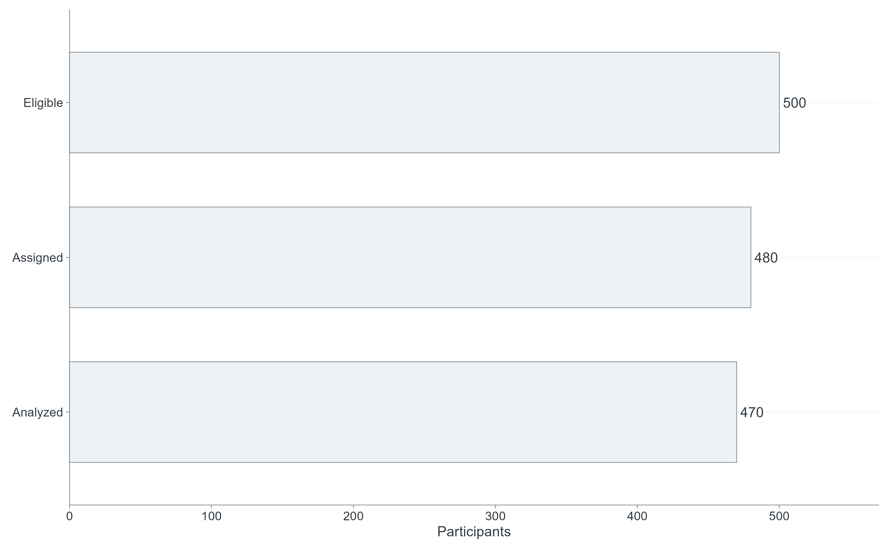
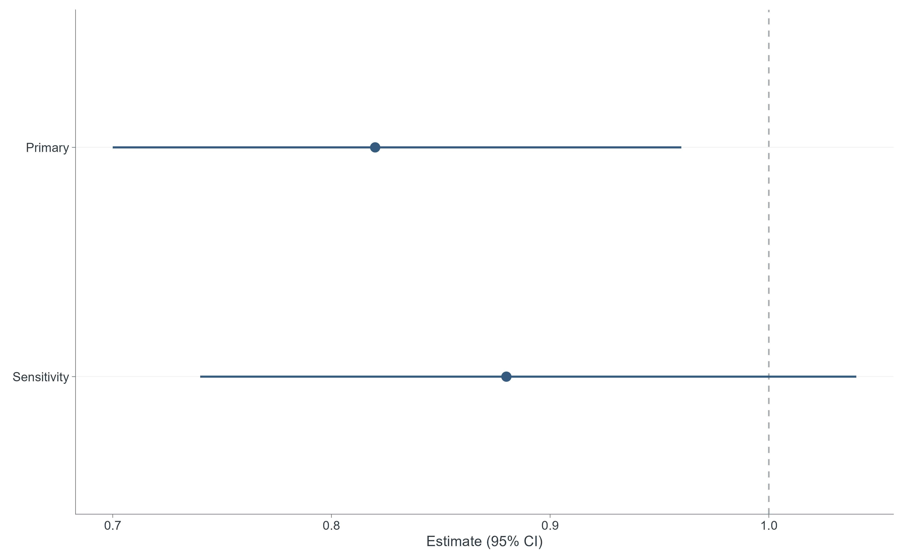
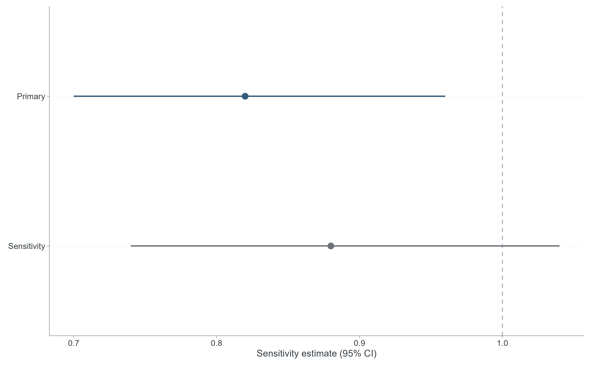

# SCI Figure Style v1.1 Candidate

Selected native documentation PNGs use the unchanged v1.0.0 synthetic fixtures. Full exports and simulations are regenerable; they are not permanent source assets.

The researcher confirmed visual PASS for the 14 cbc4424 variants at both requested widths on 2026-10-14. Study-specific publication approval remains pending.

See [visual audit](../reports/pr2_visual_audit.md), [retention audit](../reports/pr2_generated_asset_retention_audit.md), [before/after comparison](../figure_style_comparison/README.md), and [accessibility evidence](../reports/sci_palette_accessibility_validation.md).

Rebuild from repository root:

```text
Rscript figure_gallery/render_all_native_figures.R
Rscript validation/validate_sci_style_accessibility.R
python validation/validate_sci_style_exports.py
```

Full PDF/SVG/TIFF/PNG exports (both widths), original/candidate comparison pairs and CVD previews go under ignored `output/sci_style_gallery/`. Set `TTE_FIGURE_ASSET_ROOT` to choose another generation location. Only selected PNGs and small summary evidence are retained here.

## 01 cohort flow



Selected request: 178 mm. Both 85/178 mm outputs are available after regeneration.

## 02 missingness


Selected request: 178 mm. Both 85/178 mm outputs are available after regeneration.

## 03 propensity score distribution


Selected request: 85 mm. Both 85/178 mm outputs are available after regeneration.

## 04 weight distribution


Selected request: 85 mm. Both 85/178 mm outputs are available after regeneration.

## 05 love plot


Selected request: 178 mm. Both 85/178 mm outputs are available after regeneration.

## 06 standardized balance


Selected request: 178 mm. Both 85/178 mm outputs are available after regeneration.

## 07 difference forest


Selected request: 178 mm. Both 85/178 mm outputs are available after regeneration.

## 08 ratio forest



Selected request: 178 mm. Both 85/178 mm outputs are available after regeneration.

## 09 survival curve


Selected request: 85 mm. Both 85/178 mm outputs are available after regeneration.

## 10 risk curve


Selected request: 85 mm. Both 85/178 mm outputs are available after regeneration.

## 11 cumulative incidence


Selected request: 85 mm. Both 85/178 mm outputs are available after regeneration.

## 12 sensitivity forest



Selected request: 178 mm. Both 85/178 mm outputs are available after regeneration.

## 13 ccw strategy schematic


Selected request: 178 mm. Both 85/178 mm outputs are available after regeneration.

## 14 lmtp policy plot


Selected request: 85 mm. Both 85/178 mm outputs are available after regeneration.
