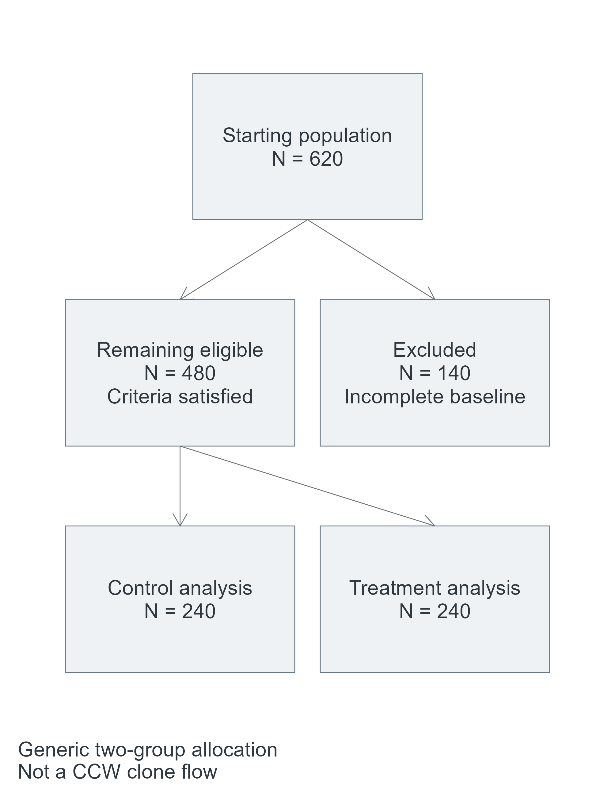
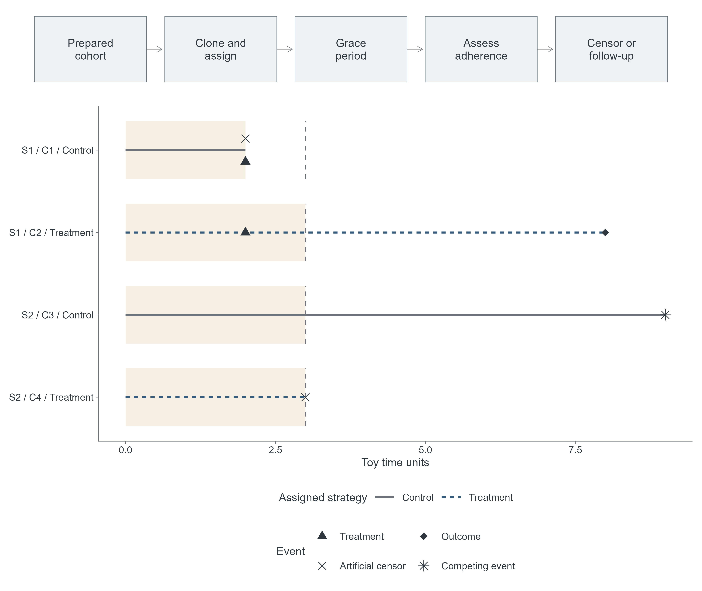
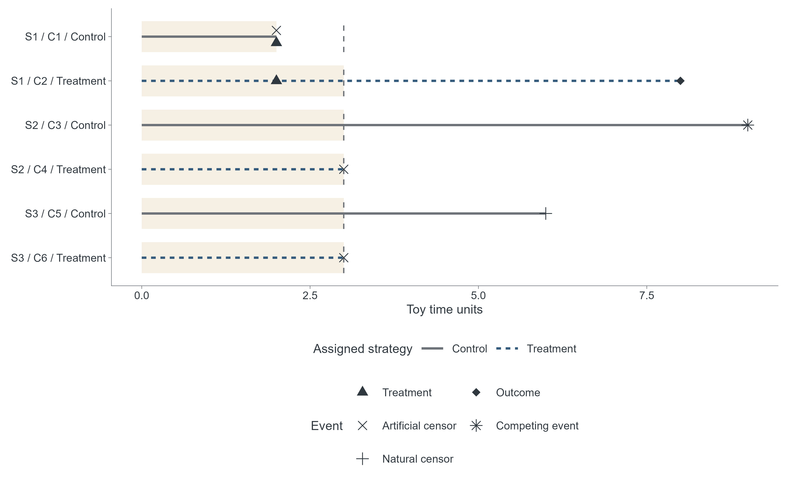
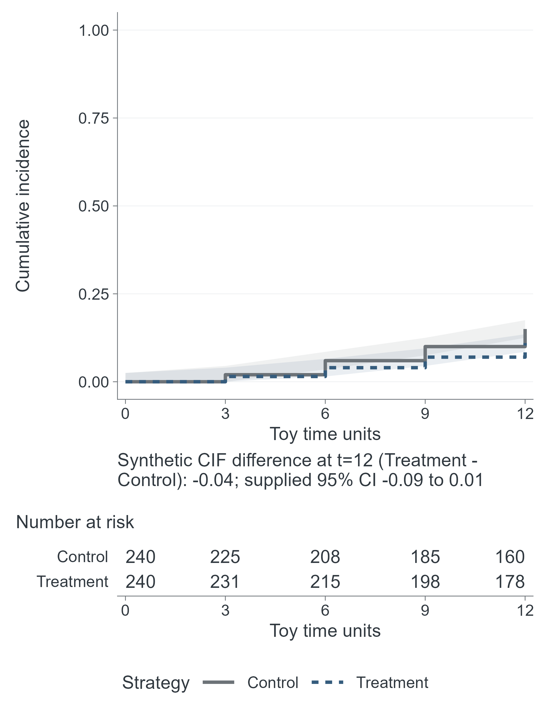
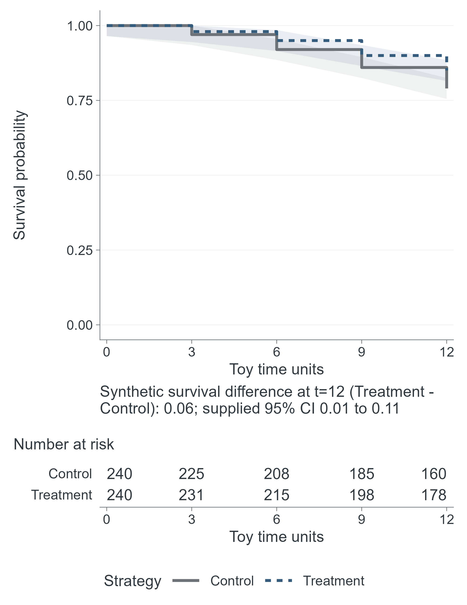
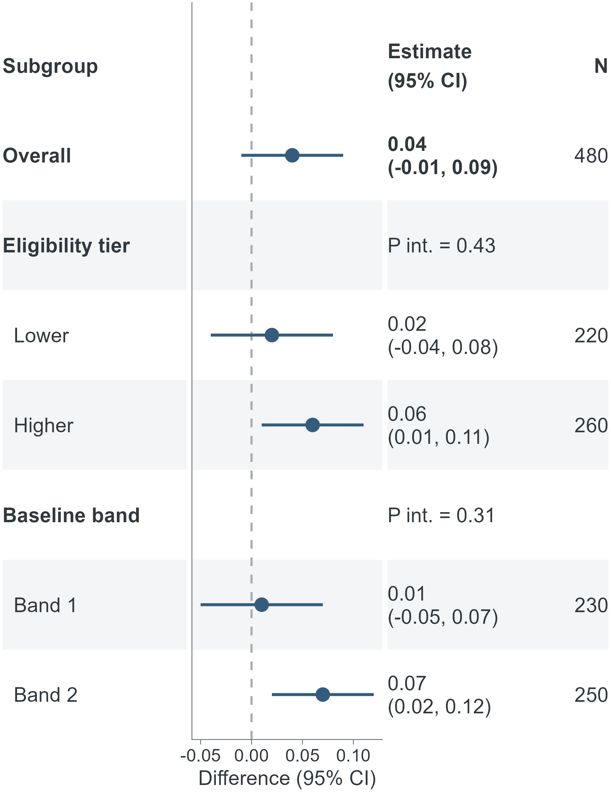
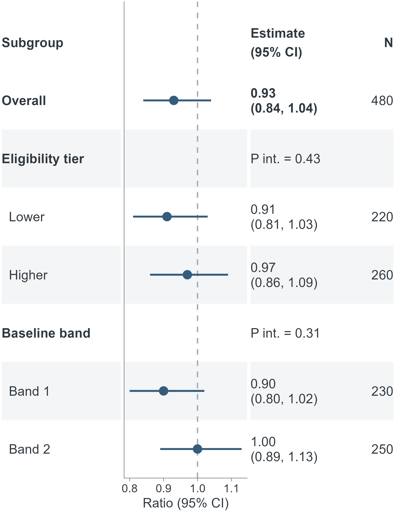
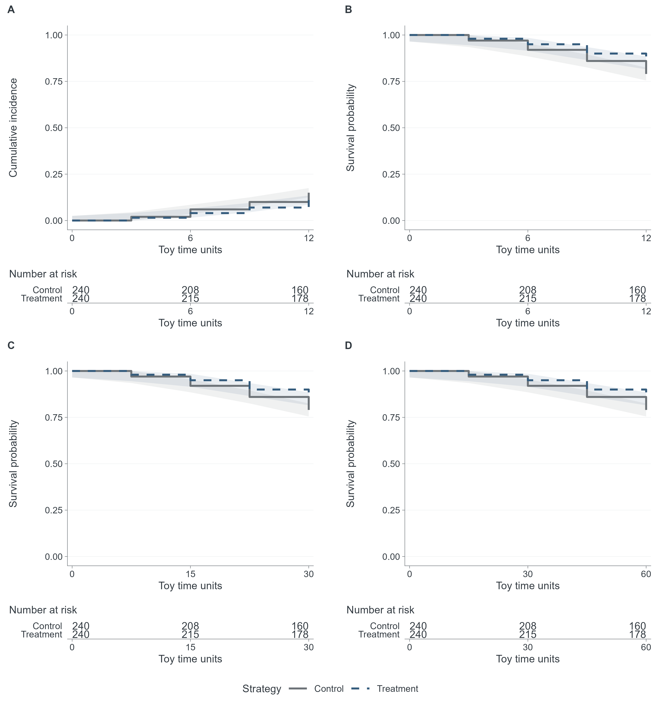
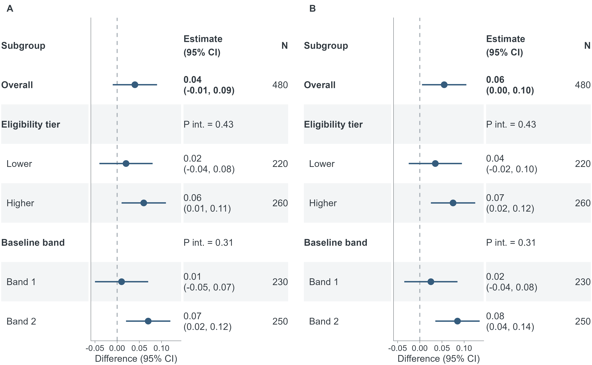

# Publication capability v1.2 candidate gallery

**SYNTHETIC_DEMONSTRATION_ONLY.** All counts, event times, curves, intervals,
interaction values and subgroup labels are original toy inputs supplied to
visualization utilities. The examples are independent, not an estimated study.
No benchmark patient data, numerical results, artwork, icons or code are used.

## Scientific meaning of the demonstrations

The flowchart is **GENERIC_PARTICIPANT_FLOW_DEMONSTRATION**: 620 starting
subjects, 140 excluded, and 480 remaining subjects split into disjoint groups
of 240/240. It is not a CCW baseline-cloning diagram. Cloning all 480 subjects
to two strategies would instead create 480 initial clones per strategy; that
different diagram is not claimed or substituted here.

The timeline fixtures now share one explicit `original_subjects` table.
S1 initiates treatment at t=2 and has an outcome at t=8; S2 has no initiation
and a competing event at t=9; S3 has no initiation and natural loss to follow-up
at t=6. Both clones inherit the same original history. The toy no-initiation
clone of S1 is artificially censored at 2; the toy initiation-by-3 clones of
S2/S3 are artificially censored at 3. Their later original terminal event is
therefore not displayed as an analysis contribution. S3 appears only in the
competing-event scene. These toy rules do not adopt a real CCW protocol.
All time axes use synthetic time units. The same-time treatment/censor marks
at t=2 do not establish a general clinical event-priority rule.

Natural censor means original subject observation loss in these fixtures,
not a clone-specific strategy deviation. Terminal event symbols replace the
redundant endpoint square; squares remain for ends without a supplied terminal
event. The [semantic QA record](../../reports/publication_capability_semantic_qa.md)
preserves the old/new fixture difference and the reproduced symbol overlap.

Risk tables are an independent non-CCW toy example: distinct original subjects
within each of two disjoint groups, immediately before t, before all outcome,
competing and censor events at t. The `risk_count_metadata` sidecar records
this convention. Counts are neither clone counts nor weighted risk-set mass,
and are not calculated from the schematic timeline or supplied curves.

Survival and CIF are separate synthetic inputs; CIF is not 1-KM. Their
annotations name the measure, difference scale, Treatment-minus-Control
direction and t=12 horizon. All displayed 95% CI bounds are explicit toy
caller inputs, not fitted confidence intervals or demonstrated coverage.
Forest P interaction values are also supplied, not inferred from CI overlap.
The 30/60 panel horizons only rescale the same synthetic survival time axis;
they are not independently estimated clinical outcomes.

Nine selected documentation PNGs are retained here. Flowcharts, individual
curves and forests use 85 mm; timelines and multi-panel figures use 178 mm.
The complete nine-case, two-width, four-format matrix (72 files) is rebuilt by
`Rscript figure_gallery/render_publication_capabilities.R` under ignored
`output/publication_capability/`. CVD/grayscale simulations and PDF/SVG review
renders are also ignored. The [manifest](../../reports/publication_capability_gallery_manifest.csv)
and [actual-file export checks](../../reports/publication_capability_export_validation.csv)
retain small, inspectable evidence. Full risk tables/forests at 85 mm were
checked separately; dense forests stack vertically at that width.

| Information architecture | Selected original demonstration |
| --- | --- |
| Generic two-group participant flow; not CCW clone counts |  |
| Research stages plus assigned clone/adherence timeline |  |
| Coherent subject histories with natural/artificial censor and terminal events |  |
| Supplied cumulative incidence, bands, annotation and risk counts |  |
| Supplied survival, bands, annotation and risk counts |  |
| Hierarchical difference-scale forest with text/N/interaction |  |
| Independently supplied ratio-scale forest, null=1 |  |
| Caller-specified outcomes/horizons with shared strategy legend |  |
| Identical subgroup rows across supplied outcome forests |  |

Use the [API guide](../../docs/figures/publication_capability_guide.md) for input
schemas and limits. `publication_ready=FALSE` and `manual_review=PENDING`
remain unchanged for every export. Machine/AI-assisted review does not approve
a real study figure. **Visualization support does not establish CCW production
readiness.**

Researcher acceptance of this gallery is software-component review. It does
not set a real study figure to `publication_ready=TRUE`; each study's inputs,
scientific meaning, final layout and figure QC require their own review.
